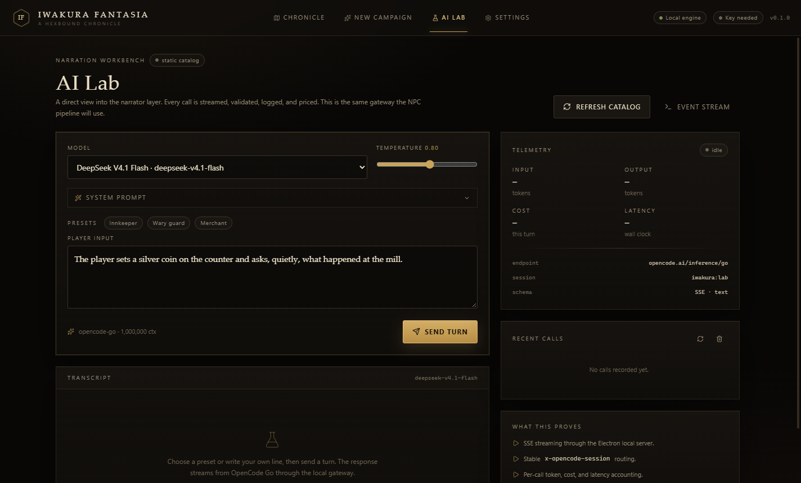
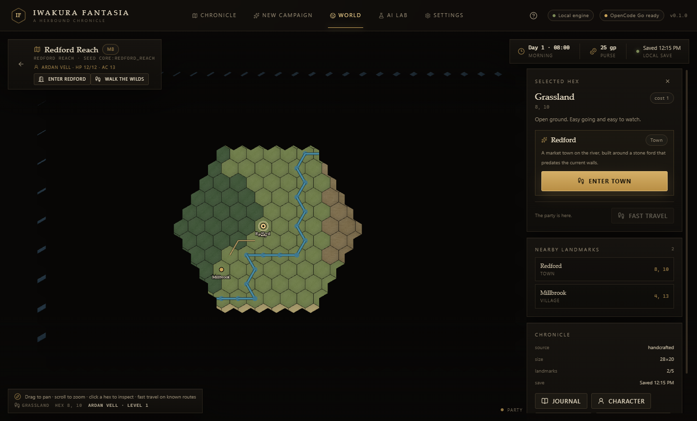
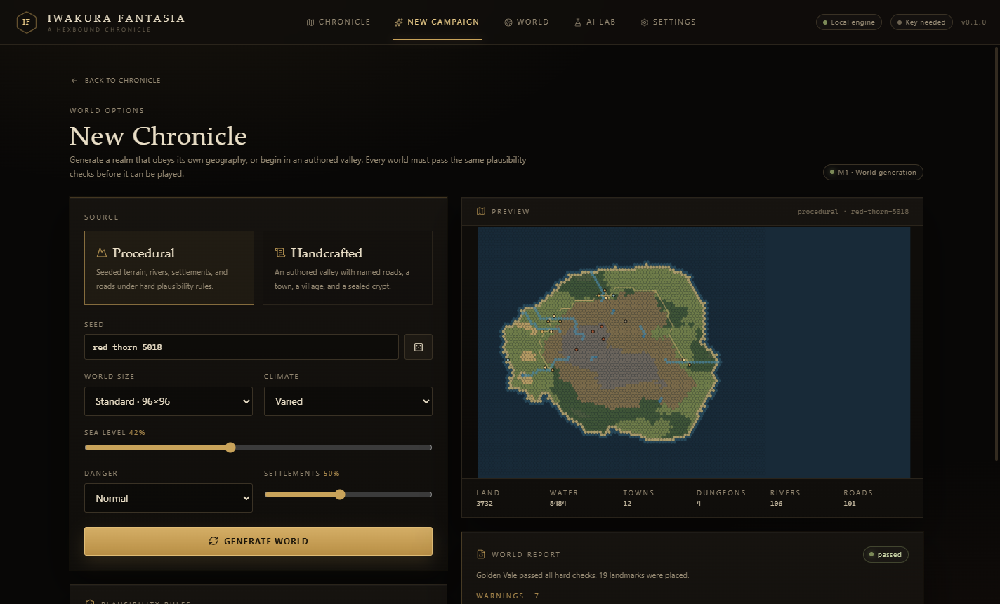
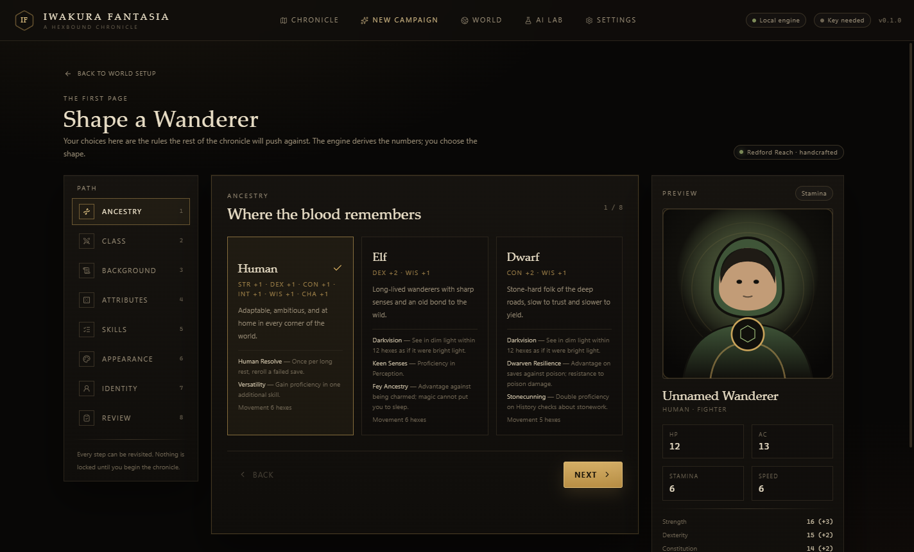
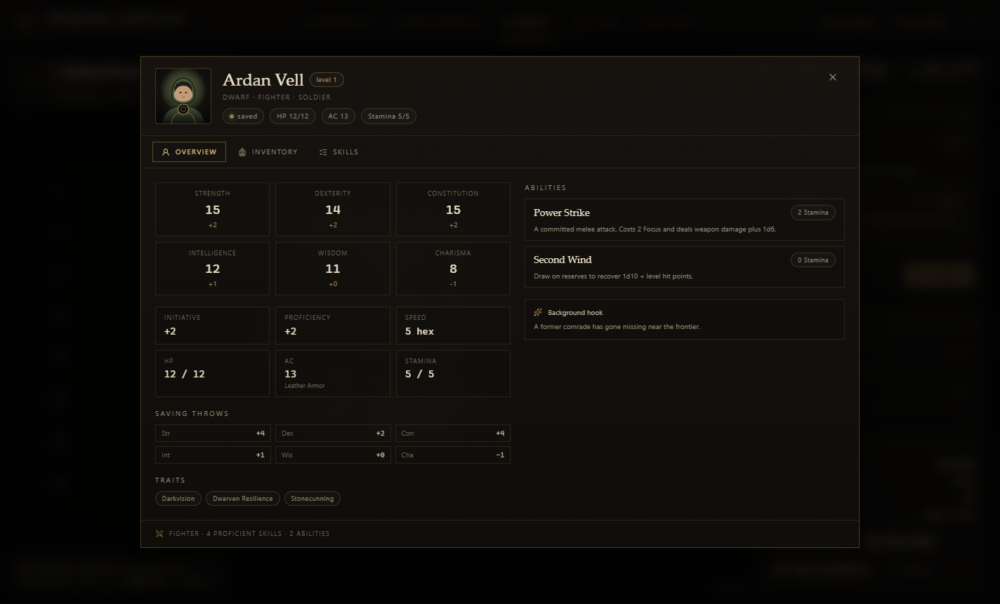

# Iwakura Fantasia

A single-player, hex-based fantasy RPG with a deterministic rules engine and an AI narrative layer.

> The engine owns the rules. The narrator owns the voice. The model proposes; the engine disposes.

**Status:** M2 character and content complete. M3 (towns, NPCs, quests) is next.
**Platform:** Windows desktop, Electron.
**Full plan:** [docs/PLAN.md](docs/PLAN.md)


---

## What works today

- **Electron desktop shell** with a sandboxed renderer, context isolation, preload bridge, and a local-only Hono server.
- **Encrypted key storage** through Electron `safeStorage`. The renderer never sees the OpenCode Go key.
- **SQLite persistence** via Node's built-in `node:sqlite` (WAL mode), with repositories for settings, AI calls, model cache, and campaigns.
- **OpenCode Go gateway** with the `x-opencode-session` header, model catalog, streaming turns, token/cost accounting, and clean provider errors.
- **AI Lab** for exercising the narrator layer: presets, system prompt, temperature, streamed transcript, raw SSE event inspector, and recent-call telemetry.
- **Settings** for provider credentials, per-role model routing, temperature, monthly budget, content rating, difficulty, and UI scale.
- **Local server API** with bearer-token auth, health, settings, model catalog, AI calls, campaign saves, and SSE test turns.
- **Procedural world generation** in a Web Worker: elevation, climate, moisture, rivers, lakes, biomes, settlements, dungeons, landmarks, and terrain-aware road networks.
- **World validation report** with hard errors and warnings before a world can be entered.
- **Handcrafted world packs** with a sample region, Redford Reach, and the same runtime schema as generated worlds.
- **PixiJS world map** with pan/zoom, fog of war, labels, hover path previews, rivers, roads, party token, and click-to-travel.
- **World time and campaign saves**: travel advances the clock, reveals fog, discovers landmarks, and persists through SQLite.
- **Character creation wizard**: 3 ancestries, 3 classes, 3 backgrounds, point buy, standard array, rolled 4d6 stats, class/background skill choices, appearance, portrait, sigil, name, and pronouns.
- **Derived character rules**: ancestry bonuses, HP, AC, Focus, speed, proficiency, saves, skills, starting kit, auto-equipped weapon and armor.
- **Character sheet** with Overview, Inventory, and Skills tabs, equip/unequip actions, and deterministic skill rolls that advance the campaign RNG.
- **Procedural portraits and sigils** generated from a seed and palette, with no external art dependency.
- **Tests**: Vitest for hex/RNG/worldgen/character/content/AI prompt/server routes (53 tests), and a Playwright Electron smoke test covering world creation, character creation, character sheet rolls, travel, save/continue, keystore round-trip, and the missing-key error path.
- **Packaged Windows build** via electron-builder (`--dir` smoke test): under 4 MB `app.asar`, no native modules.











---

## Quick start

**Requirements:** Node 24+, pnpm 10+.

```powershell
pnpm install
pnpm dev
```

Then:

1. Open **New Campaign**.
2. Choose **Procedural** or **Handcrafted**, generate a world, inspect the report, and press **Choose character**.
3. Build a character through ancestry, class, background, attributes, skills, appearance, name, and review.
4. Begin the chronicle. Drag to pan, scroll to zoom, and click a hex to travel. The clock, fog, discoveries, and save update automatically.
5. Open the **Character** sheet to inspect stats, equipment, and roll skill checks.
6. Open **Settings → OpenCode Go** and paste an API key when you want to use the AI Lab.

Without a key, the world and saves still work. AI actions return a clear configuration error instead of blocking the UI.

### Development key alternative

For running the server outside Electron:

```powershell
Copy-Item .env.example .env.local
# set OPENCODE_API_KEY in .env.local
pnpm --filter @iwakura/server dev
```

The Electron app reads the OS keystore first, then falls back to `OPENCODE_API_KEY` for development.

---

## Scripts

| Command | What it does |
|---|---|
| `pnpm dev` | Build and launch Electron with Vite HMR. |
| `pnpm build` | Build main, preload, and renderer into `apps/desktop/out`. |
| `pnpm package` | Build and produce an unpacked Windows app in `apps/desktop/release/win-unpacked`. |
| `pnpm test` | Run Vitest unit/integration tests. |
| `pnpm test:e2e` | Build and run the Playwright Electron smoke test. |
| `pnpm typecheck` | Typecheck every workspace package. |
| `pnpm lint` | Run Biome checks. |
| `pnpm format` | Format the repository with Biome. |

---

## Architecture

```
┌──────────────────────────── Electron ────────────────────────────┐
│  Main process                                                    │
│  ├─ window, menu, lifecycle, safeStorage keystore                │
│  ├─ @iwakura/server (Hono on 127.0.0.1, ephemeral port)          │
│  │   ├─ AI gateway (OpenCode Go, SSE, validation, cost logs)     │
│  │   ├─ SQLite (settings, AI calls, model cache, campaigns)      │
│  │   └─ bearer-token auth                                        │
│  └─ loads built renderer in production                           │
│                                                                  │
│  Preload bridge                                                  │
│  └─ API base + per-launch token + app metadata                   │
│                                                                  │
│  Renderer (sandboxed, no Node)                                   │
│  ├─ React 19 UI                                                  │
│  ├─ PixiJS 8 (M1 world renderer)                                 │
│  ├─ game engine package (M1+)                                    │
│  └─ typed API client + SSE                                       │
└──────────────────────────────────────────────────────────────────┘
```

### Workspace packages

| Package | Responsibility |
|---|---|
| `packages/contracts` | Zod schemas and TypeScript types for state, commands, events, AI intents, and API payloads. |
| `packages/engine` | Pure deterministic rules: hex math, A*, LOS, seeded RNG, dice, world generation, fog, travel. |
| `packages/content` | Data-driven ancestries, classes, backgrounds, abilities, items, skills, terrains, and world packs. |
| `packages/ai-kit` | NPC prompt assembly, structured parsing, token estimation. |
| `apps/server` | Hono API, SQLite repositories, OpenCode Go adapter, AI gateway. |
| `apps/desktop` | Electron main/preload/renderer shell and the current UI. |

**Dependency rule:** `engine` depends on `contracts` and `content`; `server` depends on `contracts`/`ai-kit`; nothing in `packages/*` imports from `apps/*`.

---

## AI design guardrails

The AI layer is intentionally narrow:

- The model returns narration plus a constrained list of intents.
- The engine validates every intent and applies only what is legal.
- The model never rolls dice, invents stats, or writes directly to state.
- NPC prompts get local knowledge and retrieved memories, not omniscient world state.
- Every AI call is logged with model, tokens, cost, latency, and status.
- Provider failures degrade to a visible error; they never crash the local server.
- A missing key or offline provider leaves the core UI usable.

The streaming implementation consumes the AI SDK `fullStream` and explicitly handles `error` and `abort` parts. That is deliberate: the SDK's text/usage getters can reject with `NoOutputGeneratedError` when a provider fails before sending text, which otherwise surfaces as an unhandled rejection in Node.

---

## Security notes

- Renderer: `contextIsolation: true`, `nodeIntegration: false`, `sandbox: true`.
- API server binds only to `127.0.0.1` on an ephemeral port.
- Every API route except `/api/health` requires a per-launch bearer token.
- The API key is encrypted with the OS keystore and never sent to the renderer.
- CSP restricts scripts/styles to self and connections to loopback.
- External links open in the system browser, not inside the app.
- No telemetry, accounts, cloud sync, or remote content.

---

## Current limitations

- Town/dungeon local maps, battle maps, NPC dialogue, quests, companions, and romance are planned for M3–M6.
- Character progression currently stops at level 1. Subclasses, feats, level-up UI, and level 5+ content are not implemented yet.
- Standard array is assigned through six selects; rolled stats are auto-assigned by class priority. Drag-and-drop stat assignment and manual rolled assignment are deferred.
- Class skill choices exclude skills already granted by background or ancestry. There are no expertise or tool proficiencies yet.
- The world map renders terrain in batched PixiJS layers rather than baked chunk textures. Chunk baking is deferred until larger map sizes or profiling demand it.
- The core worldgen rules cover land/water, rivers, settlements, roads, dungeons, and spacing. Ports, faction territories, resource economies, rain shadows, and full climate-band validation are deferred to M3.
- The procedural world is validated and rejects hard errors; it does not yet run an automatic repair pass. Rerolling the seed is the current repair path.
- Travel encounters are a stub. A warning toast appears, but battle maps arrive in M4.
- The handcrafted world currently generates its roads through the same terrain-aware network builder; authored road paths are supported by the schema but not used by the sample pack.
- `pnpm package` produces an unpacked Windows build; the NSIS installer target is configured but not yet signed or branded with a custom icon.
- A successful live OpenCode Go turn still needs a valid key; the error path and adapter have been verified with an intentionally invalid key.
- OpenCode Go is intended for coding-agent traffic. Treat it as a development/personal provider and keep the adapter swappable before shipping.

---

## Next milestone: M3 — Towns, NPCs, quests

- Town and dungeon local maps built on the same hex renderer.
- NPC placement, schedules, and interaction prompts.
- Authored dialogue fallback, merchant trade, and quest state machines.
- Local navigation, building interiors, and dungeon encounter triggers.
- The first town-level AI hooks, ahead of the full NPC pipeline in M5.
