# Iwakura Fantasia

A single-player, hex-based fantasy RPG with a deterministic rules engine and an AI narrative layer.

> The engine owns the rules. The narrator owns the voice. The model proposes; the engine disposes.

**Status:** All milestones M0–M8 complete. Travel Map, vertical slice, installer, and live OpenCode Go verified.
**Platform:** Windows desktop, Electron.
**Full plan:** [docs/PLAN.md](docs/PLAN.md) · **Acceptance:** [docs/ACCEPTANCE.md](docs/ACCEPTANCE.md)


---

## What works today

- **Electron desktop shell** with a sandboxed renderer, context isolation, preload bridge, and a local-only Hono server.
- **Encrypted key storage** through Electron `safeStorage`. The renderer never sees the OpenCode Go key.
- **SQLite persistence** via Node's built-in `node:sqlite` (WAL mode), with repositories for settings, AI calls, model cache, and campaigns.
- **OpenCode Go gateway** with the `x-opencode-session` header, model catalog, streaming turns, token/cost accounting, and clean provider errors.
- **AI Lab** for exercising the narrator layer: presets, system prompt, temperature, streamed transcript, raw SSE event inspector, and recent-call telemetry.
- **Settings** for provider credentials, per-role model routing, temperature, monthly budget, content rating, difficulty, and UI scale.
- **Local server API** with bearer-token auth, health, settings, model catalog, AI calls, campaign saves, and SSE test turns.
- **Procedural world generation** in a Web Worker: elevation, climate, moisture, rivers, lakes, biomes, settlements, dungeons, landmarks, and terrain-aware road networks.
- **World validation report** with hard errors and warnings before a world can be entered.
- **Handcrafted world packs** with a sample region, Redford Reach, and the same runtime schema as generated worlds.
- **PixiJS atlas/world map** with pan/zoom, fog of war, labels, hover path previews, rivers, roads, party token, and fast travel.
- **Travel Map**: each world hex expands into a deterministic detailed field map with roads, rivers, forests, settlement outskirts, edge gates, visible enemy groups, and smooth WASD movement.
- **Organic crossings**: walk through a road edge to enter the neighbouring world hex, or through a settlement gate to load its town map. Leaving a town returns to the same gate.
- **Seamless combat**: visible enemy groups auto-aggro and turn the current Travel Map into the battle field; victory, retreat, and defeat return to the field.
- **World time and campaign saves**: travel advances the clock, reveals fog, discovers landmarks, and persists through SQLite.
- **Character creation wizard**: 3 ancestries, 3 classes, 3 backgrounds, point buy, standard array, rolled 4d6 stats, class/background skill choices, appearance, portrait, sigil, name, and pronouns.
- **Derived character rules**: ancestry bonuses, HP, AC, Focus, speed, proficiency, saves, skills, starting kit, auto-equipped weapon and armor.
- **Character sheet** with Overview, Inventory, and Skills tabs, equip/unequip actions, and deterministic skill rolls that advance the campaign RNG.
- **Procedural portraits and sigils** generated from a seed and palette, with no external art dependency.
- **Town and dungeon local maps** built on the same hex geometry and pathfinding as the world map, with buildings, exits, local travel, hover paths, and save/continue inside a location.
- **NPCs with hourly schedules** across seven authored characters plus a generic road trader fallback for procedural settlements.
- **Authored dialogue** with quest-state roots, relationship changes, merchants, and a free-speech AI hook that streams an in-character reply from the local gateway.
- **Merchant trade** with per-campaign stock, buy/sell validation, gold, inventory, and equipped-item protection.
- **Quest journal and state machine**: accept, reveal targets on the map, progress reach/interact objectives, turn in for gold and items.
- **The Mill That Stopped** and **The Greywatch Light** authored quests, plus a crypt ledger, dungeon encounter trigger, inn rest, and wait controls.
- **Battle vertical slice**: initiative order, rounds, movement, melee attacks, class abilities, focus costs, shield/condition handling, simple enemy utility AI, victory/defeat/retreat, gold rewards, and a saved battle state. Encounter prompts start battles from the road or a dungeon.
- **Structured NPC AI turns**: a dedicated `/api/ai/npc` endpoint assembles the persona prompt, streams JSON from OpenCode Go, repairs common malformed intents, and validates every intent against the engine before applying disposition, memory, trade, quest, item, or combat changes.
- **Live AI verified**: a real OpenCode Go turn streamed through the local gateway at 2.2 s and $0.0001, and a live Hessa turn produced a valid AI voice plus engine-applied trust and memory changes.
- **Director and evolving quests**: validated director operations, procedural work templates, faction/rumor reactions, branching Greywatch outcomes, and a deterministic quest recap.
- **Companions**: Wren can be recruited, fights on her own turn, comments at camp, tracks approval, can be dismissed, and participates in romance gates.
- **Save and polish**: three manual save slots, JSON export/import, autosave, keyboard/accessibility pass, field guide, generated audio/VFX, high contrast, reduced motion, custom Windows icon, and NSIS installer.
- **Tests**: 99 Vitest tests and a Playwright Electron smoke test covering world and character creation, Travel Map entry, atlas fast travel, town dialogue, trade, quest completion, dungeon exploration, a battle and retreat, local save/continue, and the non-destructive keystore path.
- **Packaged Windows build** via electron-builder: 4.27 MB `app.asar`, no native modules. `pnpm package:installer` produces a 112 MB NSIS setup executable with the custom icon.

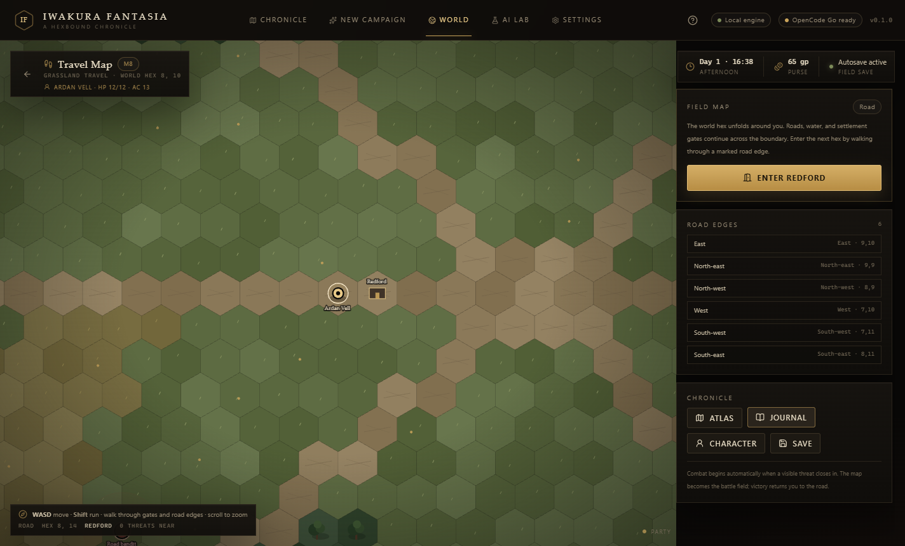

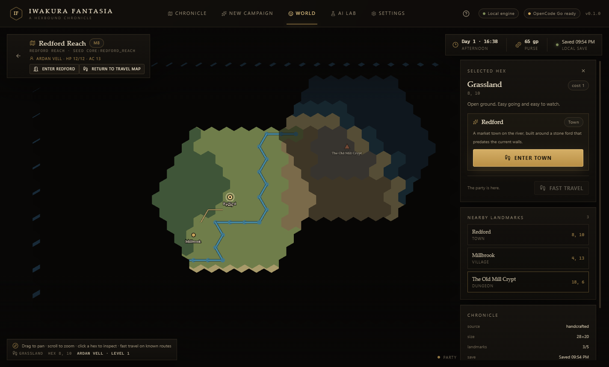

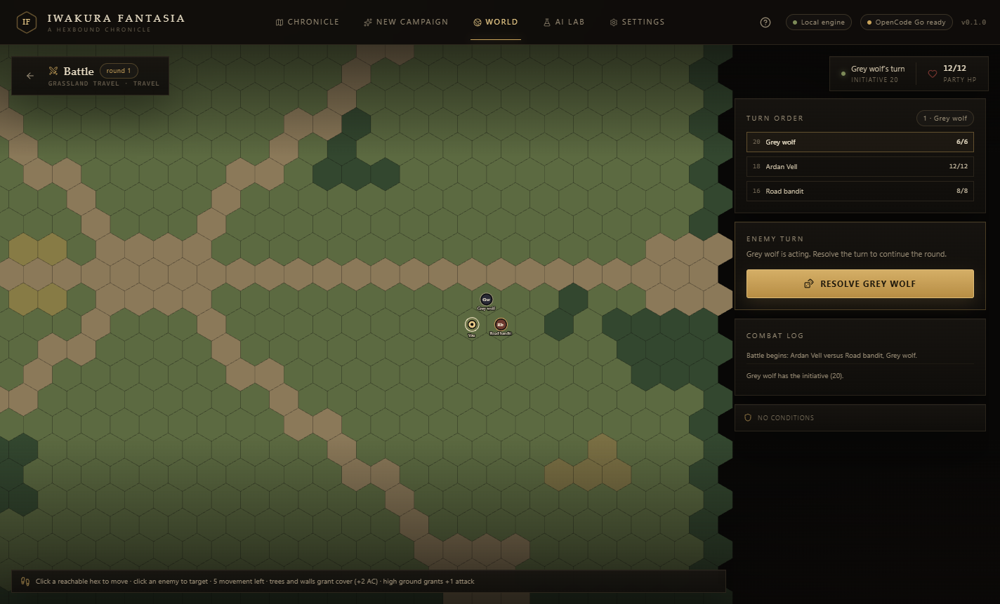


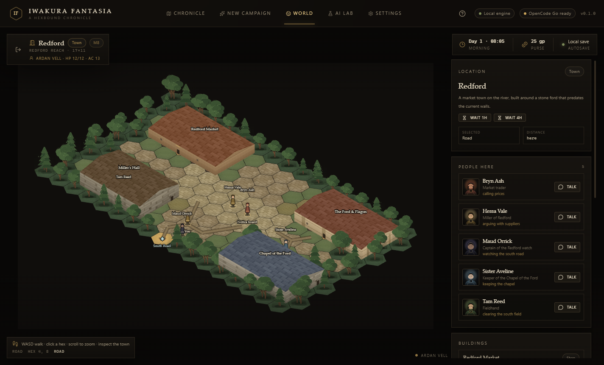

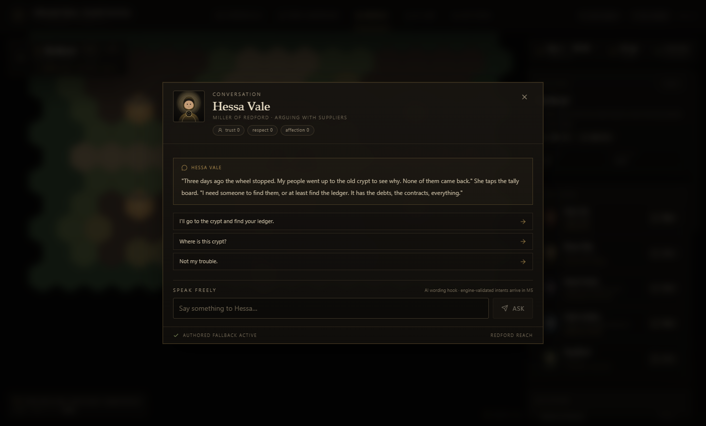

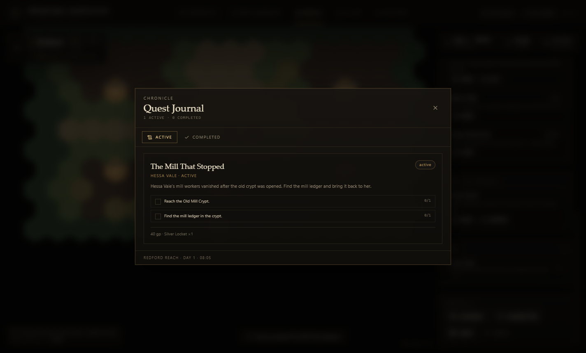

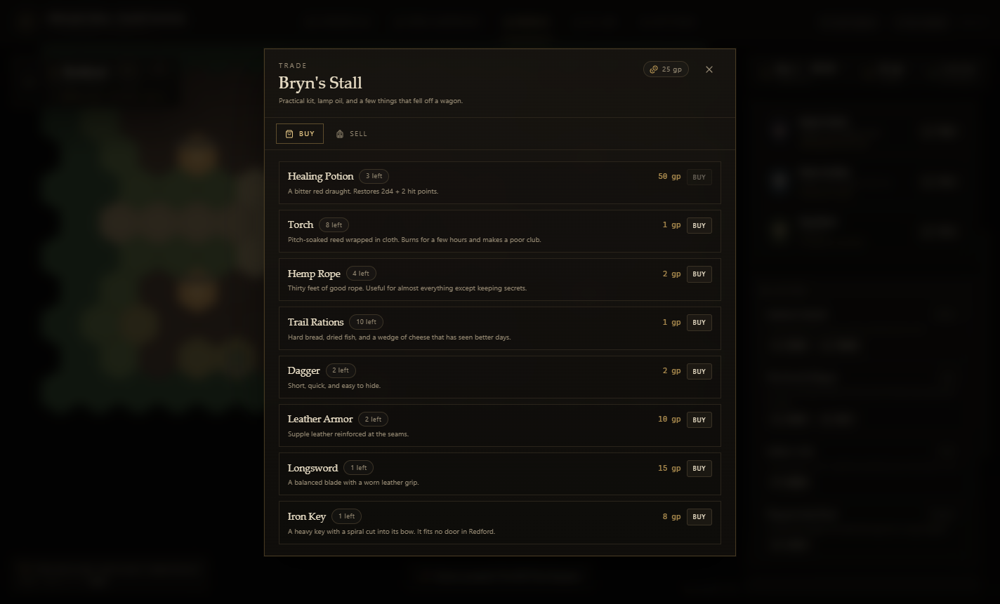

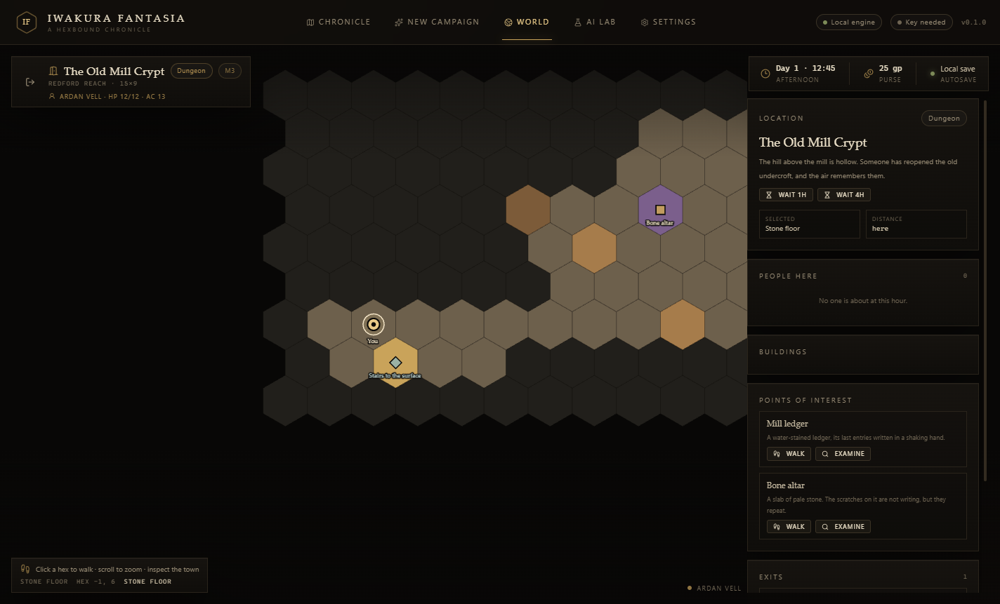

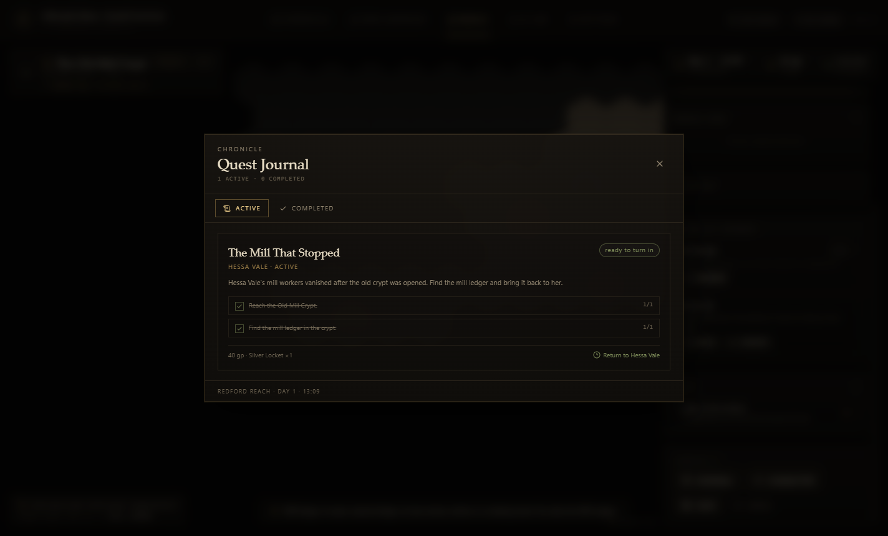

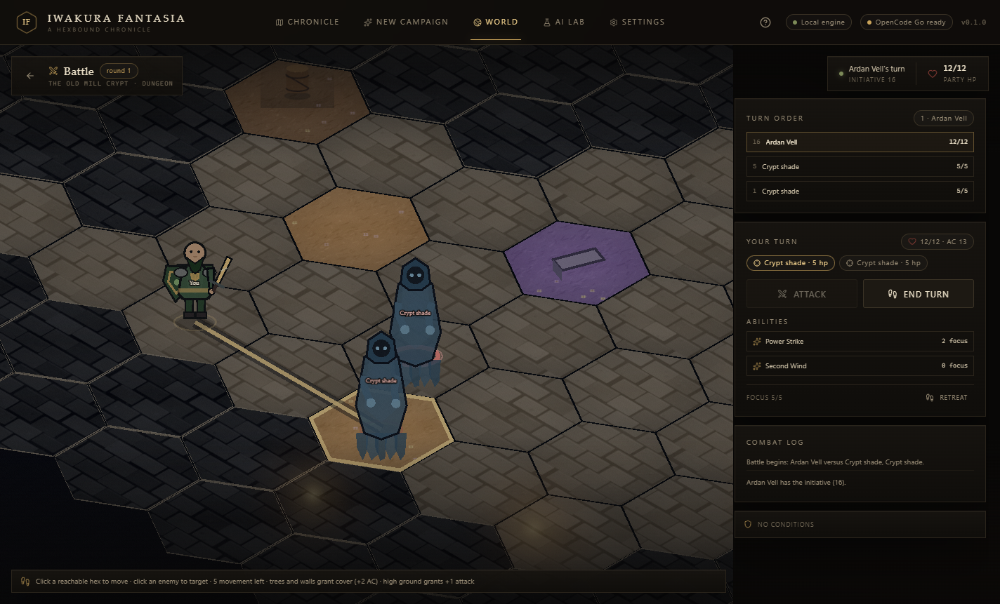

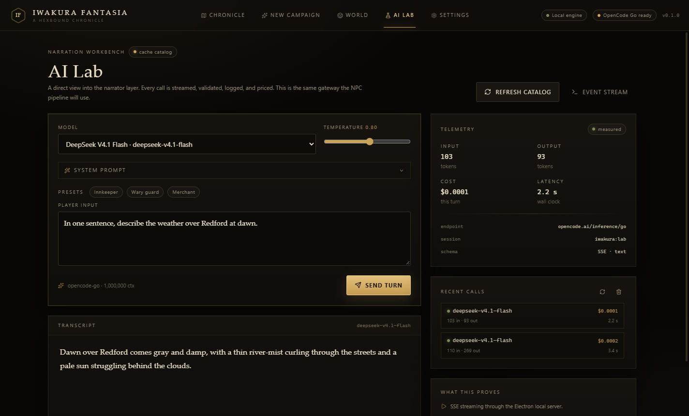

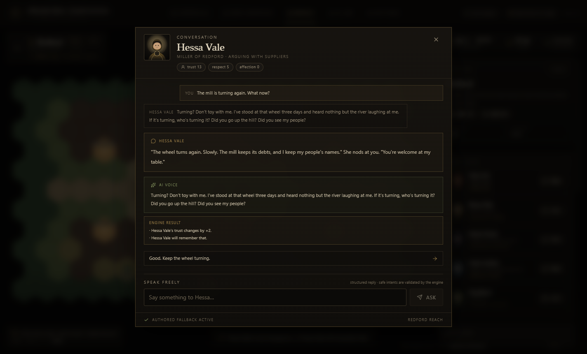

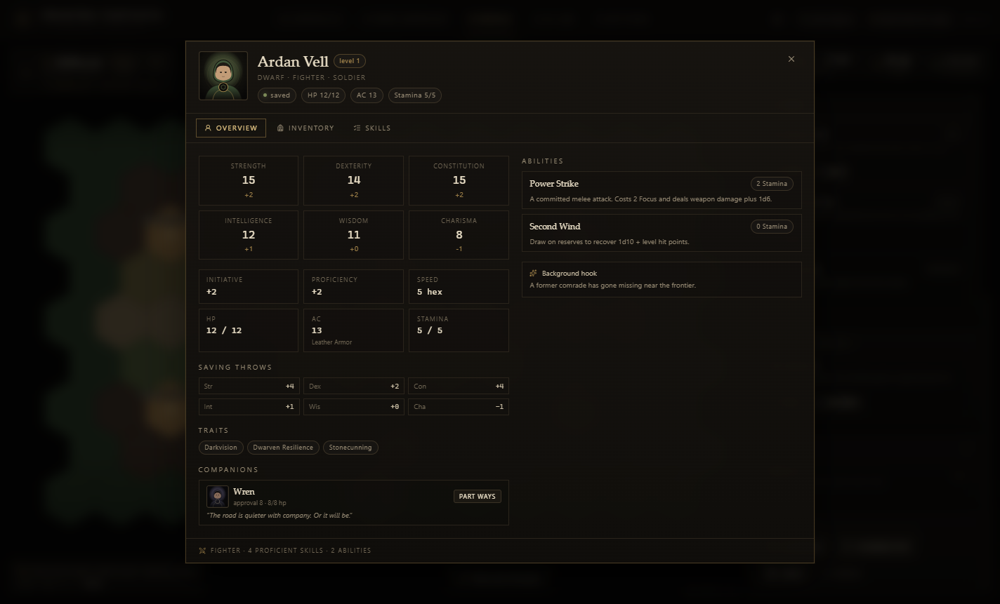

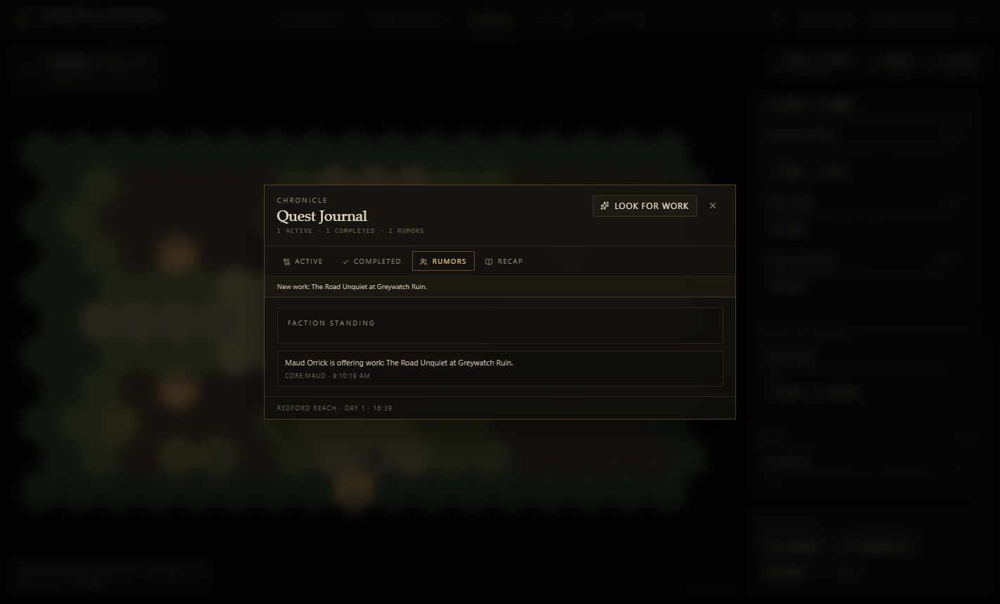

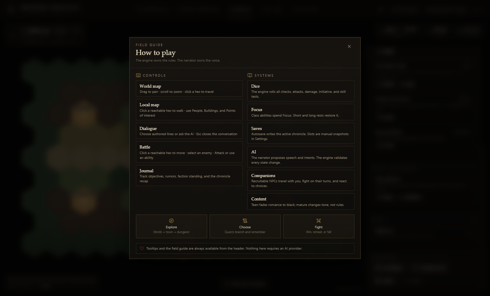

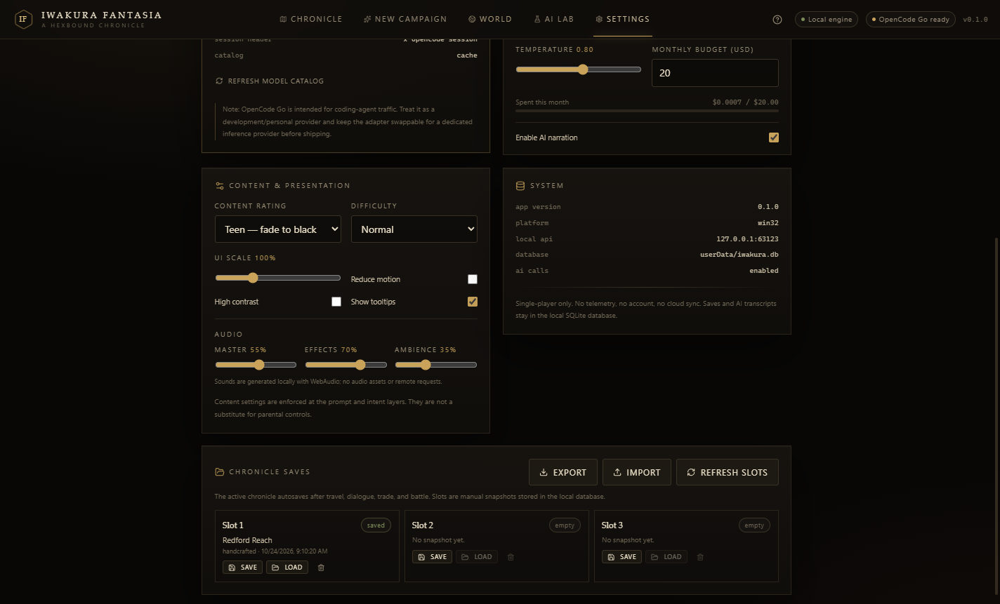

---

## Quick start

**Requirements:** Node 24+, pnpm 10+.

```powershell
pnpm install
pnpm dev
```

Or double-click **`run.bat`** to launch the packaged app. If the packaged build is missing, the script builds from source first. Use **`run.bat --dev`** for the Vite/Electron development loop.

Then:

1. Open **New Campaign**.
2. Choose **Procedural** or **Handcrafted**, generate a world, inspect the report, and press **Choose character**.
3. Build a character through ancestry, class, background, attributes, skills, appearance, name, and review.
4. Begin the chronicle. Drag to pan, scroll to zoom, and click a hex to travel. The clock, fog, discoveries, and save update automatically.
5. Walk onto Redford or Millbrook and use **Enter** to switch to the local hex map. Talk to people, trade, rest, wait, and open the **Journal**.
6. Accept Hessa's quest in Redford, travel to the Old Mill Crypt, recover the ledger, and return to her. The quest reveals the crypt on the world map.
7. In the crypt, walk into the shade encounter. The ambush panel offers **Fight** or **Avoid**. A battle uses initiative, movement, attacks, abilities, and retreat.
8. Open the **Character** sheet to inspect stats, equipment, companions, and roll skill checks.
9. Recruit Wren in Millbrook, look for generated work from the **Journal**, and use save slots or export/import in **Settings**.
10. Open **Settings → OpenCode Go** and paste an API key when you want to use the AI Lab or the dialogue AI hook.

Without a key, the world and saves still work. AI actions return a clear configuration error instead of blocking the UI.

### Development key alternative

For running the server outside Electron:

```powershell
Copy-Item .env.example .env.local
# set OPENCODE_API_KEY in .env.local
pnpm --filter @iwakura/server dev
```

The Electron app reads the OS keystore first, then falls back to `OPENCODE_API_KEY` for development.

---

## Scripts

| Command | What it does |
|---|---|
| `pnpm dev` | Build and launch Electron with Vite HMR. |
| `pnpm build` | Build main, preload, and renderer into `apps/desktop/out`. |
| `pnpm package` | Build and produce an unpacked Windows app in `apps/desktop/release/win-unpacked`. |
| `pnpm test` | Run Vitest unit/integration tests. |
| `pnpm test:e2e` | Build and run the Playwright Electron smoke test. |
| `pnpm typecheck` | Typecheck every workspace package. |
| `pnpm lint` | Run Biome checks. |
| `pnpm format` | Format the repository with Biome. |

---

## Architecture

```
┌──────────────────────────── Electron ────────────────────────────┐
│  Main process                                                    │
│  ├─ window, menu, lifecycle, safeStorage keystore                │
│  ├─ @iwakura/server (Hono on 127.0.0.1, ephemeral port)          │
│  │   ├─ AI gateway (OpenCode Go, SSE, validation, cost logs)     │
│  │   ├─ SQLite (settings, AI calls, model cache, campaigns)      │
│  │   └─ bearer-token auth                                        │
│  └─ loads built renderer in production                           │
│                                                                  │
│  Preload bridge                                                  │
│  └─ API base + per-launch token + app metadata                   │
│                                                                  │
│  Renderer (sandboxed, no Node)                                   │
│  ├─ React 19 UI                                                  │
│  ├─ PixiJS 8 (atlas, field, local, and battle renderers)          │
│  ├─ game engine package (rules, worldgen, travel, combat)         │
│  └─ typed API client + SSE                                       │
└──────────────────────────────────────────────────────────────────┘
```

### Workspace packages

| Package | Responsibility |
|---|---|
| `packages/contracts` | Zod schemas and TypeScript types for state, commands, events, AI intents, and API payloads. |
| `packages/engine` | Pure deterministic rules: hex math, A*, LOS, seeded RNG, dice, world generation, fog, atlas travel, field-map generation, and encounters. |
| `packages/content` | Data-driven ancestries, classes, backgrounds, abilities, items, skills, terrains, and world packs. |
| `packages/ai-kit` | NPC prompt assembly, structured parsing, token estimation. |
| `apps/server` | Hono API, SQLite repositories, OpenCode Go adapter, AI gateway. |
| `apps/desktop` | Electron main/preload/renderer shell and the current UI. |

**Dependency rule:** `engine` depends on `contracts` and `content`; `server` depends on `contracts`/`ai-kit`; nothing in `packages/*` imports from `apps/*`.

---

## AI design guardrails

The AI layer is intentionally narrow:

- The model returns narration plus a constrained list of intents.
- The engine validates every intent and applies only what is legal.
- The model never rolls dice, invents stats, or writes directly to state.
- NPC prompts get local knowledge and retrieved memories, not omniscient world state.
- Every AI call is logged with model, tokens, cost, latency, and status.
- Provider failures degrade to a visible error; they never crash the local server.
- A missing key or offline provider leaves the core UI usable.

The streaming implementation consumes the AI SDK `fullStream` and explicitly handles `error` and `abort` parts. That is deliberate: the SDK's text/usage getters can reject with `NoOutputGeneratedError` when a provider fails before sending text, which otherwise surfaces as an unhandled rejection in Node.

---

## Security notes

- Renderer: `contextIsolation: true`, `nodeIntegration: false`, `sandbox: true`.
- API server binds only to `127.0.0.1` on an ephemeral port.
- Every API route except `/api/health` requires a per-launch bearer token.
- The API key is encrypted with the OS keystore and never sent to the renderer.
- CSP restricts scripts/styles to self and connections to loopback.
- External links open in the system browser, not inside the app.
- No telemetry, accounts, cloud sync, or remote content.

---

## Current limitations

- Battle is a playable vertical slice: initiative, movement, attacks, class abilities, cover/high ground, LOS, shield, companion AI turns, enemy AI, VFX, victory/defeat/retreat, rewards, and saved state. Full condition durations, manual companion override, damage previews, and richer enemy tactics remain post-slice.
- Battle maps reuse the local hex renderer. Dungeon battles use the current local map; road battles generate an arena from the current terrain.
- Character progression currently stops at level 1. Subclasses, feats, level-up UI, and level 5+ content are not implemented yet.
- Standard array is assigned through six selects; rolled stats are auto-assigned by class priority. Drag-and-drop stat assignment and manual rolled assignment are deferred.
- Class skill choices exclude skills already granted by background or ancestry. There are no expertise or tool proficiencies yet.
- The world map renders terrain in batched PixiJS layers rather than baked chunk textures. Chunk baking is deferred until larger map sizes or profiling demand it.
- The core worldgen rules cover land/water, rivers, settlements, roads, dungeons, and spacing. Ports, faction territories, resource economies, rain shadows, and full climate-band validation are deferred.
- The procedural world is validated and rejects hard errors; it does not yet run an automatic repair pass. Rerolling the seed is the current repair path.
- Travel Maps use one detailed map per world hex. Each is deterministic, but currently a single biome-driven layout template; handcrafted landmark silhouettes, weather systems, patrol schedules, and local events are post-slice.
- Town and dungeon maps use a dedicated local PixiJS renderer built on the same hex geometry and pathfinding as the world map. Buildings are facade interactions; enterable interiors are deferred.
- Travel Map movement is smooth WASD after the first field is entered. Town interiors still use click-to-walk with automatic exit when an exit hex is reached.
- Fast travel is available from the atlas and consumes world time; it is not restricted to strictly discovered road segments yet.
- Handcrafted Redford, Millbrook, and the Old Mill Crypt have authored local maps and NPCs. Procedural settlements share a generic settlement layout and a generic road trader rather than unique generated towns.
- NPC schedules are hour-granular and computed from the campaign clock. NPCs do not pathfind between spots; they are placed at the active schedule spot when the local map is viewed.
- NPC memory uses lexical retrieval and deterministic summaries, not an embedding index or SQLite FTS5. AI recruitment offers remain a player-confirmed authored action.
- Quests include authored state machines, branching, procedural work templates, factions, rumors, and a recap. Quest content is still a small vertical slice.
- The handcrafted world currently generates its roads through the same terrain-aware network builder; authored road paths are supported by the schema but not used by the sample pack.
- `pnpm package:installer` builds the NSIS installer with a custom icon. The installer is unsigned, and the app is not code-signed or notarized.
- Live OpenCode Go turns are verified (streaming, usage, and cost). The E2E keystore test is skipped when a real key is configured so local runs do not delete it.
- OpenCode Go is intended for coding-agent traffic. Treat it as a development/personal provider and keep the adapter swappable before shipping.

---

## Post-slice roadmap

- More handcrafted travel maps, unique biome layouts, weather, interiors, and dungeon encounters.
- Deeper combat: full conditions, reactions, manual companion control, and richer enemy tactics.
- Travel encounters with patrols, stealth/avoidance, mounted travel, and encounter-specific objectives.
- More procedural quest templates, faction arcs, companions, and romance content.
- Optional SQLite FTS5 or embedding memory, plus stronger AI evaluation fixtures.
- Code signing, auto-update, localization, controller support, and a dedicated inference provider.
